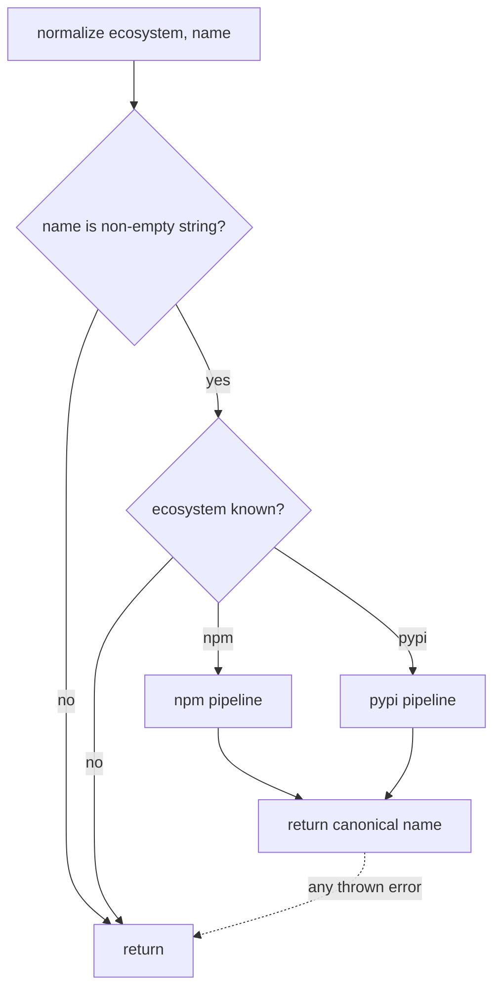

# Design Document

## Overview

This design covers `normalize(ecosystem, name)`, the single canonical-name function for Phantom Imports, exported from `packages/core/src/normalize.ts`. It is a pure, synchronous, total function: for any input it returns a string, never throws, and never performs I/O. It strips version information but never returns it. There is no other normalization logic anywhere else in the repository.

## Architecture

The function is a plain export, no class, no state:

```ts
normalize(ecosystem: Ecosystem, name: unknown): string
```

Internally it dispatches on `ecosystem` to one of two pure pipelines, with a shared guard for invalid input up front.



The whole function body runs inside a try/catch so step 3.6 ("internal error never throws") holds even if a helper misbehaves.

## Components and Interfaces

All helpers are private (not exported) pure functions inside `normalize.ts`.

- `normalize(ecosystem: Ecosystem, name: unknown): string` — the only exported function. Validates input, routes to a pipeline, catches any error and returns `""`.
- `isValidEcosystem(ecosystem: unknown): ecosystem is Ecosystem` — guards against an unknown ecosystem value at run time.
- `normalizeNpm(raw: string): string` — trims, lowercases, splits off an optional leading `@scope/`, strips a trailing `@version` from the remaining name segment, reassembles `scope + name`. Leaves `-`, `_`, `.` untouched.
- `stripNpmVersion(segment: string): string` — removes a trailing `@<version>` from a single (non-scope) segment, e.g. `react@18.2.0` → `react`. Scope detection happens before this is called, so it never sees the `@` of `@scope/`.
- `normalizePypi(raw: string): string` — trims, lowercases, strips a trailing extras block `[...]`, strips a trailing version specifier, then collapses every run of `-`, `_`, `.` into a single `-`.
- `stripPypiVersionAndExtras(raw: string): string` — removes `[...]` extras and any trailing version specifier (`==`, `>=`, `<=`, `~=`, `!=`, `>`, `<`, or bare `@version`) in either order, since extras and a version specifier may both be present (`requests[socks]==2.31`).
- `collapseSeparators(s: string): string` — replaces `/[-_.]+/g` with `-`.

No helper is exported; `Ecosystem` is imported from `./types.ts` and never redefined, satisfying the single-source-of-truth rule.

## Data Models

No new data types. The function's signature uses only:
- `Ecosystem` from `packages/core/src/types.ts` (`"npm" | "pypi"`), imported, never redeclared.
- Plain `string` for input and output. The `name` parameter is typed `unknown` at the implementation boundary (not `string`) so the run-time non-string guard (Requirement 3.4) is a real, type-checked branch rather than a cast; the public-facing declaration still documents the intended `string` usage for ecosystem-aware callers.

## Correctness Properties

*A property is a characteristic or behavior that should hold true across all valid executions of a system—essentially, a formal statement about what the system should do. Properties serve as the bridge between human-readable specifications and machine-verifiable correctness guarantees.*

### Property 1: Idempotence

For all `Ecosystem` values `e` and all strings `x`, `normalize(e, normalize(e, x)) === normalize(e, x)`.

**Validates: Requirements 5.1**

### Property 2: PyPI case and separator equivalence

For all non-empty alphanumeric words `w` and for any two ways of (a) casing `w` and (b) joining its characters with separator runs drawn from `-`, `_`, `.` of varying length, `normalize("pypi", variantA)` and `normalize("pypi", variantB)` are equal, and both equal the lowercase word joined with single `-` separators.

**Validates: Requirements 2.2, 2.3, 5.2**

### Property 3: Totality and no throw

For all values `v` (strings, numbers, `null`, `undefined`, objects, arrays, symbols) and all values `e` (valid or invalid ecosystem), calling `normalize(e, v)` never throws and always returns a `string`.

**Validates: Requirements 3.4, 3.6, 5.3**

### Property 4: Version-suffix invariance

For all `Ecosystem` values `e`, all valid base names `n` (with or without an npm scope), and any generated version suffix `v` appropriate to `e` (`@<semver>` for npm; `==`, `>=`, `<=`, `~=`, `!=`, `>`, `<` followed by a version for pypi), `normalize(e, n + v) === normalize(e, n)`.

**Validates: Requirements 1.4, 1.5, 2.5**

### Property 5: PyPI extras invariance

For all valid PyPI base names `n` and any generated extras block `[e1,e2,...]`, `normalize("pypi", n + extras) === normalize("pypi", n)`, including when a version suffix also follows the extras.

**Validates: Requirements 2.4**

### Property 6: Invalid input returns empty string

For all inputs that are (a) the empty string, (b) a string containing only whitespace, (c) any non-string value, or (d) paired with an ecosystem value outside `"npm" | "pypi"`, `normalize(ecosystem, name) === ""`.

**Validates: Requirements 3.3, 3.4, 3.5**

### Property 7: npm output shape

For all valid npm Raw_Names, the result contains no uppercase character, has no leading or trailing whitespace, preserves a leading `@scope/` when present in the input, and preserves every `-`, `_` and `.` that was part of the name (outside the stripped version suffix).

**Validates: Requirements 1.1, 1.2, 1.3, 1.6**

### Property 8: PyPI output shape

For all valid PyPI Raw_Names, the result contains no uppercase character, no leading or trailing whitespace, no `_` or `.` character, and no two consecutive `-` characters.

**Validates: Requirements 2.1, 2.2, 2.3**

## Error Handling

- The exported function wraps its entire body in `try { ... } catch { return ""; }`. No internal helper is expected to throw, but this guarantees Requirement 3.6 regardless.
- Guard clauses run before any pipeline logic:
  - `typeof name !== "string" || name.trim() === ""` → return `""` (Requirements 3.3, 3.4).
  - `!isValidEcosystem(ecosystem)` → return `""` (Requirement 3.5).
- Because `normalizeNpm` and `normalizePypi` only ever call string methods (`trim`, `toLowerCase`, `replace`, `slice`) on a value already confirmed to be a string, no runtime exception is expected from them; the outer try/catch is defense in depth, not the primary correctness mechanism.

## Testing Strategy

**Unit tests** (Vitest), covering concrete examples and edge cases called out in the requirements and glossary:
- `react@18.2.0` → `react`; `@types/node@20` → `@types/node`.
- `requests[socks]==2.31` → `requests`.
- `Requests` / `REQUESTS` → `requests`; `re_quests`, `re.quests`, `Re--Quests`, `re-quests` → `re-quests`.
- `"" `, `"   "`, non-string values (`123`, `null`, `undefined`, `{}`, `[]`), and an unknown ecosystem string all return `""`.
- A bare unscoped name with no version or special characters round-trips unchanged except for lowercasing.

**Property-based tests** (fast-check, `pnpm add -D fast-check` already a devDependency per technique.md), one test per property above, each configured for a minimum of 100 runs and tagged with a comment referencing its design property:

```ts
// Feature: s1-normalize, Property 1: Idempotence
fc.assert(
  fc.property(fc.constantFrom("npm", "pypi"), fc.string(), (e, x) => {
    const once = normalize(e, x);
    return normalize(e, once) === once;
  }),
  { numRuns: 100 }
);
```

Generator notes:
- A shared `alphanumericWord()` arbitrary (lowercase letters/digits, length 1–20) is the base for name generation, combined with a `separatorRun()` arbitrary (`-`, `_`, `.` repeated 1–3 times) to build PyPI variants for Property 2.
- A `versionSuffix(ecosystem)` arbitrary produces `@` + semver-like strings for npm and operator + version strings for PyPI, used in Property 4.
- An `extrasBlock()` arbitrary produces `[name(,name)*]` strings for Property 5.
- Property 3 uses `fc.anything()` for `name` and a mix of `fc.constantFrom("npm", "pypi")` and `fc.anything()` for `ecosystem` to cover both well-typed and malformed call sites.

All tests run offline; no fixture or network access is needed since `normalize` has no I/O.
