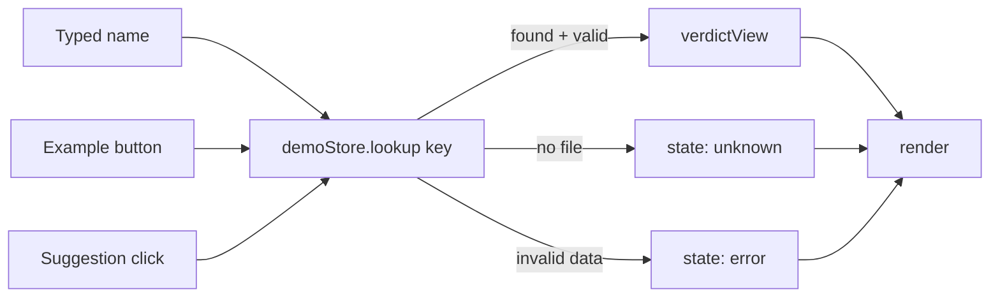

# Design Document

## Overview

The autopsy page is a static Vite + TypeScript page in `apps/web`, with no framework. It only displays a `Verdict` that was produced elsewhere. It never recomputes a verdict and never calls a provider (Requirement 9).

Milestone 1 delivers the verdict card for three demo packages. Verdicts are bundled at build time, so the page makes no network call at runtime (Requirement 8).

Design decisions:

- **Types only from core.** `apps/web` depends on `@phantom/core` (`workspace:*`) and uses `import type` exclusively. There is no runtime import from `@phantom/core` in milestone 1, because `normalize` does not exist yet (Requirement 2.5, 2.6, 9.1).
- **Bundled verdicts.** `import.meta.glob` with `eager: true` loads `demo/verdicts/*.json`. No `fetch` is used.
- **Pure view model.** `verdictView(verdict)` prepares everything the card shows. It has no DOM dependency, so it can be tested directly. `render.ts` only turns a view model into DOM.
- **Typed name is used as is.** In milestone 1 the lookup key is `npm__<name>` with the name exactly as typed. `apps/web` defines no normalization function (Requirement 2.3, 2.6).

### File layout

```
apps/web/
├── index.html            lang="en", mounts #app
├── package.json          adds @phantom/core (workspace:*), vitest, fast-check
├── src/
│   ├── vite-env.d.ts     /// <reference types="vite/client" />
│   ├── main.ts           wiring: events, state, calls store -> view -> render
│   ├── demoStore.ts      glob import, type guard, lookup by key
│   ├── verdictView.ts    pure: Verdict -> VerdictView
│   ├── render.ts         DOM rendering of states and the card
│   └── styles.css        palette tokens, system fonts
└── test/
    ├── verdictView.test.ts   unit tests + property 2
    ├── demoStore.test.ts     unit tests for the 3 fixtures and the type guard
    └── demoMode.test.ts      property 1 (fetch never called)
```

`vite-env.d.ts` is needed because `tsconfig.base.json` loads only the node and pnpm types, and `pnpm lint` (tsc at the repository root) must pass with `import.meta.glob`.

## Architecture



Flow: the three inputs produce a package name. `main.ts` builds the key `npm__<name>` and calls `demoStore.lookup`. A valid verdict goes through `verdictView`, then `render`. A missing key gives the `unknown` state. Data that fails the type guard gives the `error` state.

## Components and Interfaces

### demoStore.ts

```ts
import type { Verdict } from "@phantom/core";

const files = import.meta.glob("../../../demo/verdicts/*.json", {
  eager: true,
  import: "default",
}) as Record<string, unknown>;

export type LookupResult =
  | { kind: "found"; verdict: Verdict }
  | { kind: "unknown" }
  | { kind: "invalid" };

export function isVerdict(x: unknown): x is Verdict;
export function lookup(name: string): LookupResult; // key = `npm__${name}`, unchanged
```

- The map is indexed by the file name stem (`npm__demo-ghost-lib`). The glob path prefix and `.json` suffix are stripped.
- `lookup` does an exact key match. Any name other than the three demo names returns `unknown`. No trimming, no lowercasing.
- `isVerdict` is a small structural guard. It does not redefine `Verdict`. It checks at the boundary: `contractVersion` is a string, `action` is one of ALLOW/REVIEW/BLOCK, `diagnosis` is one of the five codes, `reasons` is an array of 0 to 3 strings when `action` is ALLOW and an array of 1 to 3 strings when `action` is REVIEW or BLOCK (contract invariant I8; the current Judge returns `reasons: []` for ALLOW), `headline` is a string, `signals` and `seams` are arrays, `package.name` is a string. If a file exists but fails the guard, `lookup` returns `invalid`.

### verdictView.ts

```ts
import type { Verdict, Action, Diagnosis } from "@phantom/core";

export type ColorToken = "ectoplasm" | "candle" | "blood" | "pumpkin";

export interface VerdictView {
  packageName: string;       // verdict.package.name
  ecosystem: string;         // verdict.package.ecosystem
  actionWord: Action;        // "ALLOW" | "REVIEW" | "BLOCK"
  icon: "✓" | "⚠" | "✗";
  actionColor: ColorToken;   // fill color of the action badge and headline
  diagnosisTag: Diagnosis;   // shown as a tag
  diagnosisColor: ColorToken;
  headline: string;          // verbatim
  reasons: string[];         // verbatim, same order
  suggestionText?: string;   // `Did you mean ${name}?`
  suggestionName?: string;   // used by the click handler
}

export function verdictView(v: Verdict): VerdictView;
```

Mapping tables (constants in `verdictView.ts`):

| Action | Icon | Color token |
|---|---|---|
| ALLOW | ✓ | ectoplasm |
| REVIEW | ⚠ | candle |
| BLOCK | ✗ | blood |

| Diagnosis | Color token |
|---|---|
| LIVING | ectoplasm |
| GHOST | blood |
| POSSESSED | pumpkin |
| CURSED | blood |
| FOG | candle |

Rules:

- `headline`, `reasons` and the suggestion name are copied from the verdict without change (Requirement 9.2).
- `suggestionText` is only set when `v.suggestion` exists.
- The view model never contains organ names, because it does not read `signals` or `seams` in milestone 1 (Requirement 3.11).
- Text on any colored fill is Night. The CSS enforces this (see Theme).

### render.ts

```ts
export type PageState =
  | { kind: "empty" }
  | { kind: "loading" }
  | { kind: "unknown"; name: string }
  | { kind: "error"; message: string }
  | { kind: "verdict"; view: VerdictView };

export function render(root: HTMLElement, state: PageState, handlers: Handlers): void;

export interface Handlers {
  onSubmit(name: string): void;
  onExample(name: string): void;
  onSuggestion(name: string): void;
  onRetry(): void;
}
```

- `render` is the only module that touches the DOM. It rebuilds the content of `#app` from the state.
- Fixed content: a "Summon a package" form (label, text input, submit button) and three example buttons (`demo-healthy-lib`, `demo-ghost-lib`, `demo-possessed-lib`). Both are always shown, so the `unknown` state also offers the examples (Requirement 7.3).
- State outputs:
  - `empty`: text inviting the visitor to pick an example.
  - `loading`: "Summoning…" message.
  - `unknown`: "No demo autopsy for this package".
  - `error`: message and a Retry button.
  - `verdict`: the card with action word + icon, headline, diagnosis tag, reasons list, and the suggestion as a `<button>`.
- Text is set with `textContent`, never `innerHTML`, so verdict strings cannot inject markup.

### main.ts

- Holds the current `PageState` and the last submitted name (for Retry).
- `submit(name)`: set `loading`, call `lookup(name)`, map the result to `verdict`, `unknown` or `error`, then render. In milestone 1 the lookup is synchronous, so `loading` is shown only for the state transition. It is kept so the same code path works in online mode (milestone 4).
- Example buttons and suggestion clicks call `submit` with the given name.

## Data Models

The page defines no domain type. It uses `Verdict`, `Action`, `Diagnosis` from `@phantom/core` (type-only). Its own types are `VerdictView`, `PageState`, `LookupResult` and `Handlers`, all view-level.

Demo verdict files (Requirement 1), one JSON object each, conforming to `Verdict` with `contractVersion` `"1.0.0"` and `demo: true`:

| File | Action / diagnosis | Signals | Other |
|---|---|---|---|
| `npm__demo-healthy-lib.json` | ALLOW / LIVING | none required | 0 to 3 reasons (I8) |
| `npm__demo-ghost-lib.json` | BLOCK / GHOST | `registry.not_found` | suggestion `demo-healthy-lib` |
| `npm__demo-possessed-lib.json` | BLOCK / POSSESSED | `eye.install_script`, `eye.network` | each Evidence names file and line, for example `scripts/postinstall.js:3` |

Every non-ALLOW file has 1 to 3 reasons. The ALLOW file may have 0 to 3 (I8). Every file has a headline of at most 80 characters. Every signal has at least one `Evidence` item.

Note: under I8 the healthy fixture may carry 0 reasons. Requirement 1.7 says 1 to 3 reasons. This is a known difference, to be reconciled in requirements.md.

## Theme and Styling

- `styles.css` defines tokens as CSS custom properties: `--night #1A1024`, `--mist #EEE8F4`, `--pumpkin #E8772E`, `--ectoplasm #6EE7A8`, `--candle #F2C14E`, `--blood #FF5C6C`.
- Page background is Night, body text is Mist.
- Any element with a colored fill (action badge, diagnosis tag, buttons) uses Night as text color (Requirement 3.6). Color is applied by a class derived from the token name, for example `.fill-blood`.
- Fonts in milestone 1: system fallback stacks only. Text uses `system-ui, sans-serif`. Package names, versions and commands use `ui-monospace, monospace`. No `@font-face` and no remote URL anywhere (Requirement 3.12). Inter, JetBrains Mono and Creepster self-hosted files arrive in milestone 2 (Requirement 3.7, 3.8).
- Color is never the only signal. The action badge always contains icon and word, for example `✗ BLOCK`. With `NO_COLOR` or forced-colors modes the card stays readable because of the word and icon (Requirement 3.10). Add a `@media (forced-colors: active)` rule that keeps borders on badges.
- Contrast pairs used (from the design-theme steering): Mist on Night 15.3, Night on Ectoplasm, Candle, Pumpkin and Blood all above 4.5:1 (Requirement 3.9).

## Accessibility

- A single `<main>` with an `<h1>`. The form uses a `<label for>` on the input.
- The state region has `aria-live="polite"` and `role="status"`. The `error` state uses `role="alert"`.
- Example buttons, submit, suggestion and retry are native `<button>` elements, so Enter and Space work with no extra code (Requirement 2.4).
- After rendering a verdict, focus stays where the user acted. The live region announces the result.
- `lang="en"` on `<html>` in `index.html`.

## Error Handling

| Situation | State | Notes |
|---|---|---|
| Nothing summoned yet | `empty` | No verdict, so no ALLOW (Requirement 7.5) |
| Lookup in progress | `loading` | Same |
| No file for the typed name | `unknown` | "No demo autopsy for this package" plus three example buttons |
| File exists but fails `isVerdict` | `error` | Message plus Retry (Requirement 7.4) |
| Unexpected exception in lookup or render | `error` | Caught in `main.ts` |

- Only the `verdict` state can show ALLOW, a LIVING tag or a green (Ectoplasm) element. `render` for `empty`, `loading`, `unknown` and `error` uses no Ectoplasm class.
- Retry calls `submit` again with the last name. If there was no last name, it returns to `empty`.
- The guard rejects instead of repairing. Unknown shapes never get a default favorable value.

## Milestone Mapping

Consistent with Requirement 11.

| Milestone | Scope | Design impact |
|---|---|---|
| 1 | Requirements 1, 2 (except 2.5), 3 (except 3.7, 3.8, badges, house), 7, 8, 9 (except 9.5) | Everything above |
| 2 | Requirement 4, 2.5, 3.7, 3.8, 9.5 | Add `seamBadges` to `verdictView`. Replace the as-typed key with `normalize(ecosystem, name)` imported at runtime from `@phantom/core`. Self-host fonts in `apps/web` |
| 3 | Requirements 5, 6 | New modules `house.ts` (SVG from `eye.*` signals) and `timeline.ts` (from `clock.*` evidence), plus the text chronology |
| 4 | Requirement 10 | `submit` gains an async online path with `POST /api/check`. The demo path stays fetch-free |

Only milestone 1 is detailed. The rest is a sketch.

## Correctness Properties

*A property is a characteristic or behavior that should hold true across all valid executions of a system-essentially, a formal statement about what the system should do. Properties serve as the bridge between human-readable specifications and machine-verifiable correctness guarantees.*

### Property 1: Demo mode never calls fetch

*For any* string typed into the input and submitted in Demo_Mode, including empty, whitespace, unicode and path-like strings, the Autopsy_Page SHALL call `globalThis.fetch` zero times.

**Validates: Requirements 8.1, 8.2**

### Property 2: Non-ALLOW verdicts display at least one reason

*For any* `Verdict` with action REVIEW or BLOCK and 1 to 3 reasons, `verdictView` SHALL return a view whose `reasons` equal the verdict's reasons in the same order, so at least one reason is displayed.

**Validates: Requirements 1.7, 3.3, 9.2**

## Testing Strategy

Tools: Vitest and fast-check, run through the root `pnpm test`. Tests use no real network. `apps/web` needs `vitest`, `fast-check` and a DOM environment (`happy-dom`) for `demoMode.test.ts` only.

- Test files that need the DOM declare `// @vitest-environment happy-dom` at the top of the file. The root Vitest config stays in the node environment.
- After adding dependencies (including `happy-dom` and the `@phantom/core` `workspace:*` dependency), `pnpm-lock.yaml` is updated and committed, because CI uses `--frozen-lockfile`.

Property tests (minimum 100 runs each, using the fast-check default or `numRuns: 100`). Each carries a tag comment:

1. `demoMode.test.ts`
   - Tag: `Feature: s8-autopsy-page, Property 1: Demo mode never calls fetch`.
   - Stub `globalThis.fetch` with `vi.fn()`. Mount the page, then for each `fc.string()` (plus `fc.unicodeString()`) submit it through the form. Assert `fetch` has 0 calls, and the state is `unknown` unless the string equals one of the three demo names.
2. `verdictView.test.ts`
   - Tag: `Feature: s8-autopsy-page, Property 2: Non-ALLOW verdicts display at least one reason`.
   - Arbitrary: build a `Verdict` (typed with the imported contract type) with `fc.constantFrom("REVIEW","BLOCK")` for action, `fc.array(fc.string({minLength:1}), {minLength:1, maxLength:3})` for reasons, any diagnosis, and an optional suggestion. Assert `view.reasons.length >= 1` and `view.reasons` deep-equals the input.

Unit tests (examples):

- `demoStore.test.ts`: the three files pass `isVerdict`. Healthy is ALLOW/LIVING. Ghost is BLOCK/GHOST with a `registry.not_found` signal and suggestion `demo-healthy-lib`. Possessed is BLOCK/POSSESSED with `eye.install_script` and `eye.network`, each with an Evidence value naming file and line. All have `demo: true`, a headline of at most 80 characters, and 1 to 3 reasons for non-ALLOW (0 to 3 for ALLOW). `isVerdict` rejects objects with a missing field, an unknown action, or four reasons. It accepts an ALLOW with 0 reasons and rejects a BLOCK with 0 reasons. `lookup("Demo-Ghost-Lib")` returns `unknown` (as typed, no normalization).
- `verdictView.test.ts`: table checks for the action and diagnosis mappings. ALLOW gives `✓` and `ectoplasm`. BLOCK gives `✗` and `blood`. POSSESSED gives `pumpkin`. Ghost fixture gives `suggestionText` `Did you mean demo-healthy-lib?`. Clicking the suggestion in the DOM test loads the healthy verdict.
- `render` checks (happy-dom): `empty`, `loading`, `unknown` and `error` outputs contain no "ALLOW", no "LIVING" and no `fill-ectoplasm` class. The `error` state has a Retry button. The verdict card contains the action word and icon as text.
- Smoke: `styles.css` and `index.html` contain no `http://` or `https://` font URL and no `@import`. `index.html` has `lang="en"`.

PBT is not used for `render` (DOM output) or CSS. Those use example and smoke tests.
